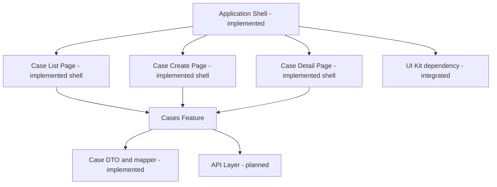
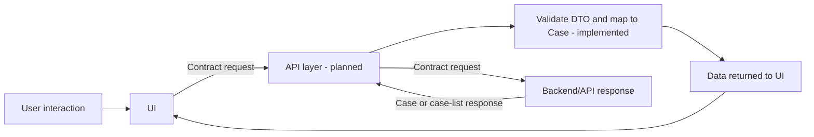

# 1. Component Diagram

# 2. Data-flow Diagram

# 3. State Taxonomy

| State type | Purpose | CaseFlow example | Where it belongs |
|---|---|---|---|
| Server state | Remote API data and request status | Case list or detail response | Cases feature API/hooks |
| URL state | Shareable navigation and list configuration | `/cases` and `/cases/:id` with search parameters | React Router/pages |
| Form state | Temporary create/edit input and validation | New-case title and description draft | Create/edit form component |
| Local UI state | Ephemeral behavior within one component | Open row action or loading/error display | Owning page/component |
| Global client state | State shared across distant features | Simulated user role or session context | Application-level client state |
| Tool selection state | Tracks the active UI tool or action | Not currently applicable; no tool-selection workflow is defined. | Not applicable until required. |
